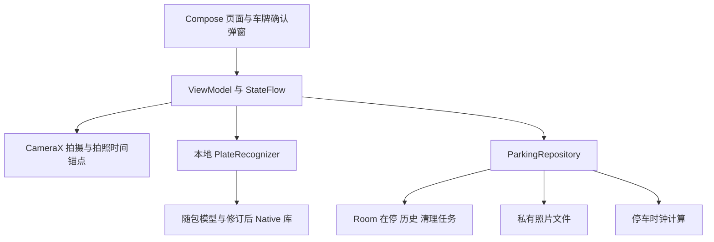
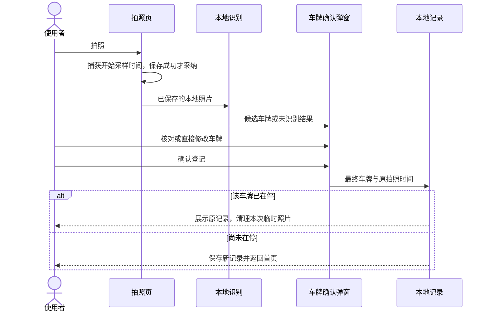

# ParkTick 技术方案

- 日期：2026-10-31
- 需求依据：[停车计时需求文档](../requirements/planned/parking-timer.md)
- 实施安排：[实施计划](../requirements/planned/implementation-plan.md)
- 状态：原生 Android 业务源码、Debug、混淆 Release 和测试 APK 已实现并构建；正式验收尚未完成。目标双机、原生 ARM / 16KB 与完整三类车牌样本门禁仍未关闭，当前证据见第 10 节。
- 验证更新：2026-11-02，证据与未关闭项见[运行验证记录](../reference/verification.md)。

## 1. 技术决策

采用原生 Android：Kotlin、Jetpack Compose / Material 3、CameraX、Room，以及随安装包交付模型的本地车牌识别引擎。业务代码先放在单个 `:app` 模块内按职责分包，不建立服务端，不引入账号、网络接口、常驻服务或多套识别引擎。

| 层次 | 决策 | 目的与约束 |
| --- | --- | --- |
| 页面 | Compose、Material 3、Navigation Compose | 四个页面目的地；车牌确认在拍照页弹窗完成，不另建确认页 |
| 状态 | ViewModel、StateFlow、协程 | UI 单向更新；数据库、解码和推理不阻塞主线程 |
| 拍照 | CameraX Preview + ImageCapture | 只在拍照后识别，不持续分析预览帧 |
| 本地数据 | Room / SQLite | 唯一约束和事务维护停车状态，不靠页面判断防重复 |
| 图片 | 内部私有、不备份的文件目录 | 不进入系统相册；历史不保留照片 |
| 识别 | HyperLPR3 固定源码、本地修订后构建 | 首选技术路线；不直接把未经验证的旧 AAR 当作可交付依赖 |
| 计时 | 同次开机用单调时钟，跨重启按墙钟估算 | 无后台计时服务，明确系统改时的物理边界 |
| 依赖装配 | Application 中集中创建少量组件 | 暂不引入依赖注入框架、多模块业务框架或通用插件系统 |

### 1.1 构建与设备基线

下列版本已经写入工程并完成构建；`app/gradle.lockfile` 和 `gradle/verification-metadata.xml` 锁定实际解析依赖与校验值，不使用动态版本或 SNAPSHOT。

| 项目 | 基线 |
| --- | --- |
| Android | `minSdk 24`（Android 7.0），`compileSdk 36`、`targetSdk 36` |
| Java / Gradle | JDK 17、Gradle 8.13、AGP 8.13.2 |
| Kotlin / 编译插件 | Kotlin 2.2.21，Compose Compiler 插件同版本；KSP 2.2.21-2.0.4 |
| Compose | BOM 2025.10.01；由 BOM 管理 UI / Material 3，不另行混配版本 |
| CameraX / Room | CameraX 1.5.1；Room 2.8.3 |
| 其他 AndroidX | Navigation 2.9.5、Lifecycle 2.9.4、Activity 1.11.0；完整依赖见版本目录及锁文件 |
| Native | NDK r28c `28.2.13676358`、CMake 3.22.1、MNN 2.9.6、OpenCV 4.10.0；源码 commit 与 SHA-256 固定 |
| ABI | Release 打包 ARM64 / ARMv7；Debug 额外打包 x86_64，供本机 API 36 模拟器验证，不冒充 ARM 实测 |
| 安装方式 | 先交付本地安装 APK；未承诺应用商店上架及其额外政策合规 |

来源见第 12 节。设备支持需以 M0 / M5 的实测矩阵为准；模拟器能运行列表不等于已经验证 ARM 识别库。

### 1.2 用户实际使用设备与必测矩阵

用户已指定坚果 Pro 3 和 Redmi Note 14 Pro 5G，两款均作为必测设备，不以其中一台通过代替另一台。两台分别独立安装、各自保存本地记录，车牌在停唯一性约束作用于各自数据库，不新增跨设备同步。

| 必测设备 | 已确认型号与公开硬件资料 | 验证重点 |
| --- | --- | --- |
| 坚果 Pro 3 | 官方页面列出骁龙 855 Plus；实际内存、Android 版本和 ROM 状态未读取 | CameraX 拍照 / 对焦 / 方向、模型初始化与连续识别内存、返回和进程恢复 |
| Redmi Note 14 Pro 5G | 用户已确认 5G 版、天玑 7300-Ultra；实际内存和当前 Android / ROM 版本未读取 | 相机与权限、前后台切换、弹窗键盘 / 大字体、本地识别与连续运行 |

- M0a 对两台分别读取具体型号、地区 / SKU、Android release / API、ROM 版本、实际 ABI、物理内存和内存页大小；Smartisan OS / HyperOS 的产品版本号不能直接当成 Android API 级别。
- 不由 CPU 的 64 位能力推断当前系统的 ABI 列表，也不由机型新旧或 Android 大版本推断是否使用 16KB 内存页。
- M0b 使用同一套合法照片和相同推理输入规格，分别记录冷启动首次识别、热运行 P50 / P95 和连续 30 次识别后的内存变化；不按上市年份预判谁更快，不将公开配置冒充实测耗时。
- 两台均须覆盖拍照、编辑车牌、重复登记、结束删除、历史、退出 / 锁屏 / 重启及大字返回行为。即使两台都是 4KB 系统，也不取消既定的 16KB 兼容门禁；低版本与 ARMv7 兼容验证同样保留。

## 2. 离线车牌识别路线与阻塞门禁

### 2.1 固定来源，不直接照搬示例工程

- Java SDK 参考 tag `1.0.3`，commit `2c87e056dce87a9edcb93a7fe0096a132c3a59ca`：[官方仓库](https://github.com/HyperInspire/hyperlpr3-android-sdk/tree/1.0.3)。
- Native 源码基点：`9307450f7b7915be18f23a539ec05b41fe6629f4`：[HyperLPR](https://github.com/szad670401/HyperLPR/tree/9307450f7b7915be18f23a539ec05b41fe6629f4)。此基点与旧预编译库的构建对应关系尚未证明，不混称为同一可追溯制品。
- 使用固定 SDK tag `1.0.3` 的 `assets/r2_mobile/` 六个本地 MNN 模型。实际工程在 `:app` 内直接源码构建自有 JNI，静态链接 MNN 与 OpenCV `core,imgproc`，产物为 APK 内 `libparktick_lpr.so`；不再额外交付没有独立消费者的 AAR，也不链接旧预编译 SDK。模型随 APK 交付，首次使用不联网下载。
- 上游代码及 SDK POM 声明 Apache-2.0。必须进一步归档所用模型、MNN、OpenCV 及静态链接组件的具体来源、版本、许可和 NOTICE；仓库许可证不等于训练数据和全部二进制授权链均已完成核实。
- 上游对普通单层黄牌有支持声明，双层黄牌仅称有限支持；不据此承诺双层黄牌效果，也不将其偷偷列入已经通过的识别验收。

已读旧 SDK 源码存在需要处理的风险：

1. Java facade 默认向 app-specific external files 复制模型；仅设置 `modelPath` 不能阻止该额外复制。修订为内部私有目录初始化，并显式传播复制和 context 创建失败。
2. `release()` 后未重置初始化标志，不能照搬“每次离开页面 release、回来再 init”的生命周期。
3. JNI 识别路径未见配对的数组与 data buffer 释放；这是源码风险，不冒充已经复现的已发布二进制泄漏。接入前核对并修订资源所有权。
4. JNI 通过类名与 getter / setter 查找对象；需要最小必要 keep 规则，验证 release 混淆构建，不能只测 debug。
5. 本次取得 tag `1.0.3` 的 ARM64 `.so`，两个 `PT_LOAD` 段均为 `0x1000`（4KB）对齐，不满足 16KB ELF 对齐要求。升级 App 的 AGP / NDK 不会自动修复这个预编译库，必须重编并验证相应依赖；这不是已经运行过 16KB 设备的故障复现。

本地修订包括离线初始化、资源释放、失败传播、必要混淆规则与 native 兼容性，并修正检测网络未传递配置线程数的问题，明确使用 CPU 后端；不改训练模型，不增加在线识别或第二套引擎。来源及修订说明归档于 `third_party/sources.lock.json` 和 APK 的 `assets/licenses/`。

识别解码已由逐帧贪心改为宽度 32 的 CTC 前缀束搜索，分别累计 blank / nonblank 概率，正确处理重复字符。普通单层牌使用独立颜色分类推断 7 / 8 字符长度；未知类别与双层分行不强加该长度。颜色分类也可能错误，不能据此保证候选位数或整牌正确，仍须用户核对。

MNN 的浮点 softmax 实测会出现 `1.00024414`，因此校验有限非负行分数并逐行归一化，而非按严格 `<= 1` 拒绝有效输出；字符置信度同样来自归一化后的实际对齐概率。固定模型输出为 20 × 78，词典有 77 项；未定义类别不能越界索引或生成字符。空结果、非法张量与不可行路径明确失败，复用结果不累积旧字符。未交换单张图片通道、修改训练权重或按样本注入字符；修改过的上游文件有显式修订标记。

### 2.2 先行验证通过条件

| 门禁 | 通过条件 | 当前证据状态 |
| --- | --- | --- |
| G1 来源与制品 | 固定源码及依赖版本，构建可复现 JNI / APK，记录模型、native 库、APK 校验值 | 已源码构建 Debug / Release；模型与源归档 SHA-256 已锁定，具体构建证据单独记录 |
| G2 许可 | 归档适用许可证、版权与第三方 NOTICE，记录所用模型及依赖的分发声明 | 已随包归档 HyperLPR、MNN、OpenCV / Carotene、C++ runtime 和 JVM 依赖声明；上游未提供独立模型卡或训练数据权利证明，不宣称完成训练数据审计 |
| G3 JNI 与初始化 | 内部模型目录、初始化失败可见、释放配对、重复调用内存、混淆构建验证 | 缺失模型失败、重复推理 / 重建、x86_64 连续调用内存观察已执行；16KB 模式下 ARM64 翻译环境的未改动 R8 包已实际启动并通过正检 JNI / 构造器探针；目标双机持续运行与内存仍待验 |
| G4 ABI 与页大小 | ARM64 / ARMv7 可运行；64 位 native 依赖及 APK 对齐合格；ARM64 16KB 环境冷启动和重复识别通过 | 全部打包 64 位 ELF 与 APK 静态对齐通过；已执行 API 35 的 16KB 模式与 `libndk_translation` ARM64 路径。Intel 主机直接启动 ARM64 / ARMv7 镜像实际失败；翻译环境不代替原生 ARM64 16KB 或 ARMv7 真机 |
| G5 真实离线识别 | 首次安装即断网，无网络权限，三类车牌实际识别；记录结果、耗时、内存及失败样本 | 原蓝 / 绿牌精确回归通过；固定公开挑战集蓝牌 26/30、绿牌 11/30 整牌正确，错误和未检出均保留；黄牌演示图正确但不算 30 张授权样本库，不能泛化这些数字或正式放行 |

M0 完成前，不把识别引擎标记为已接入完成。若任一门禁失败，解决该门禁或重新评估离线引擎；不得用“全部手动输入”、在线 API 或虚构识别结果代替需求。

### 2.3 输入、候选和生命周期

- 应用仅依赖一个 `PlateRecognizer` 边界；实现负责本地初始化和返回候选，不负责登记、去重、计时或照片删除。
- 读取 JPEG 后处理 EXIF 方向，再以 SDK 规定的像素格式推理。压缩 JPEG 字节不能直接当原始像素 `byte[]` 传入；rotation 使用 SDK 常量，不直接传角度数值。
- 旧 Bitmap 入口会分配整图 `int[]`，不称为零拷贝。修订时避免反复解码、全图多份复制；推理输入限制到经过样本验证的合理尺寸，UI 缩略图按显示尺寸解码。
- 一个引擎实例在单一工作线程串行使用，不为每张照片重复加载模型，不让多个页面并行访问同一个 native context。
- 候选取取景范围内可信度最高的一项预填；无法确定或未检出时留给同一弹窗手动核对，不额外增加候选选择页面。任何候选均不能自动登记。
- 一次拍摄一个 draft 标识。返回、取消或重拍后，旧推理结果不得再次弹出或保存记录。
- 单次未识别到车牌是正常结果，可手动填写；模型缺失、ABI 加载失败和引擎初始化失败是接入故障，不能伪装成识别成功或把项目验收降级为手工登记。

## 3. 应用结构与职责

业务代码按 `ui`、`camera`、`recognition`、`data`、`time`、`media` 分包。上游修订源码及其许可证单独管理，不在 UI 中散布 JNI 调用。

| 组件 | 责任 |
| --- | --- |
| 页面 / ViewModel | 展示、输入草稿、弹窗与导航；不直接写文件或拼接 SQL |
| 拍摄协调 | 当前照片、捕获时间、保存结果、返回和重拍的取消边界 |
| PlateRecognizer | 本地模型初始化、方向与格式处理、候选结果和明确错误 |
| ParkingRepository | 按最终车牌登记、唯一冲突处理、结束事务、列表和历史查询 |
| 停车时钟 | 墙钟 / 单调钟锚点、重启识别、时长来源及时间异常标记 |
| 照片存储 | 文件归属、删除任务执行和无引用临时文件回收 |

内部操作围绕 `register(draft, finalPlate)`、`finish(recordId, confirmationTime)`、`observeActive(query)`、`observeHistory(query)` 组织。登记区分新建 / 已在停 / 保存失败；结束区分已保存并清理 / 已保存但清理未完成 / 保存失败，不能用一个布尔值掩盖状态差异。当前不定义 HTTP API。

## 4. 拍照时间与确认登记

CameraX 1.5.1 的 `onCaptureStarted()` 对同次拍摄先于 `onImageSaved()` 调用。采用下述事件定义，不将写盘完成或识别完成时间偷换为拍照时间：

- `onCaptureStarted()` 入口采样墙钟、`elapsedRealtime()` 与 boot 标识，暂存本次拍照事件锚点。
- 对应 `onImageSaved()` 成功后，才采纳该锚点并执行识别；保存失败丢弃本次照片和锚点。
- 该时间是应用收到拍照开始通知的近似事件时间，不代表传感器曝光 UTC 或毫秒级物理曝光精度。
- 采样与回调在轻量执行路径处理，不在计时采样前进行模型加载、解码或数据库操作。

弹窗只保留可编辑车牌、照片缩略图、拍照时间、“确认登记”“重新拍照”和明确返回入口。返回与外部 dismiss 均按取消登记处理；系统返回先遵循输入法 / 弹窗处理，再执行页面导航。确认失败保留当前输入和照片，提示失败，不虚报保存成功。

## 5. 数据模型与一致性

使用两张业务表和一张照片删除任务表，避免手写 Room 无法直接声明的部分唯一索引。

| 表 | 主要字段与约束 |
| --- | --- |
| `active_parking` | `id` 主键；`normalizedPlate` 唯一且非空；`startWallMs`、`startElapsedMs`、`startBootCount`；唯一的 `photoName` |
| `parking_history` | `id` 沿用本次停车标识；车牌、起点锚点、`endWallMs`、`durationMs`、`durationBasis`、时间异常标记；没有照片字段 |
| `pending_photo_deletions` | `recordId` 主键，归属的 `photoName`；与历史记录同事务写入，供提交后的文件删除恢复使用 |

- 进行中 / 已结束由所在表表达，不再维护一份可漂移的重复状态字段。
- 车牌仅做一致的空白清理、全角 ASCII 归一化和字母大写；不自动猜改省份、`O/0` 或 `I/1`。去重与搜索使用同一规范化规则，最终内容仍由用户确认。
- 禁止 `INSERT OR REPLACE`、覆盖式 upsert 或以车牌作为历史主键；冲突必须返回原在停记录。
- 在停按 `startWallMs ASC`，历史按 `endWallMs DESC`；同时间以记录标识作稳定次序。查询参数绑定，不拼接用户输入为 SQL。
- Room 迁移显式维护 schema，不使用破坏式迁移清空用户停车数据。

### 5.1 登记

照片以随机记录 / draft 标识命名，拍照后即在受管理的私有目录中，不按车牌命名，也不在确认时重复复制原图。

确认时只使用最终编辑后的车牌，在事务中检查并插入 `active_parking`；数据库唯一约束是并发和重复点击的最终防线。冲突时取得原记录，当前 draft 照片被清理；保存失败保留可重试的当前草稿，不删除其他在停记录照片。页面提交期间禁用重复提交，不将按钮禁用当成唯一保护。

### 5.2 结束与照片删除

最终确认按钮点击时采样结束锚点，只计算一次本次时长。在同一 Room 事务中：写入历史、写入照片删除任务、移除在停记录。事务失败全部回滚，原记录继续在停，原照片保留。

事务提交后才删除照片、应用生成的裁剪 / 缩略副本及内存缓存；文件已不存在视为删除完成。确认删除成功后移除对应删除任务。删除失败不能回滚已经提交的真实结束时间，也不能显示“照片已删除”；应明确显示“停车已结束，照片清理未完成”，保留恢复任务。

在应用启动和每次 `ON_RESUME` 回到前台时重试遗留删除任务，不依赖是否经过 `ON_STOP`；计时刷新仍仅在前台 `STARTED` 范围运行。恢复成功只清除该次恢复观察到的清理警告，以通知实例身份比较，不能清掉较晚的新提示。文件名按记录标识区分，同一车牌再次停车后旧任务不得删新照片；回收时保护在停、待删和当前有效草稿。

不设置常驻清理服务。应用被强制停止或一直不再运行时，无法保证失败删除的完成时限；正常结束立即清理，中断后下次运行恢复。此限制必须如实说明，不把“历史无照片入口”伪装成“物理文件已删除”。删除承诺是应用存储不再保留可访问照片与副本，不是闪存取证意义的不可恢复擦除。

## 6. 计时与系统时间边界

| 情况 | 计算与展示 |
| --- | --- |
| 同次开机，boot 标识可靠且单调钟有效 | `nowElapsedMs - startElapsedMs`；锁屏、深睡、退出重开和系统改时不改变间隔 |
| 已跨重启，或 boot 标识无法可靠取得 | 不跨启动相减单调钟；用 `nowWallMs - startWallMs` 估算，并标记估算来源 |
| 墙钟倒退导致负差值等无法恢复的情况 | 标记时间异常、显示“时长无法准确恢复”；不把负数截成 0 后冒充准确结果 |
| 已结束记录 | 保存最终时长和计算依据，之后不随当前时间增长 |

API 24 起可用 `Settings.Global.BOOT_COUNT` 判断开机周期；读取失败按“不可靠”处理，不能假装仍在同次开机。记录保留墙钟用于日期展示和跨重启估算，不能仅保存单调钟。

已发现的系统改时异常单独标记；若无法重建时长，允许结束并保留起止时间，`durationMs` 为空且 `durationBasis=UNKNOWN`，界面明确显示不可准确恢复，不填写伪造总时长。这是离线时间异常策略，不改变正常时钟下的计时验收。

完全离线、设备已经重启且系统时间可任意修改时，没有足够信息保证真实经过时间可准确重建。跨时区只影响格式化展示，不重新解释已保存的 epoch 时间。

在停列表使用一个随前台生命周期运行的共享秒级刷新信号计算可见行时长；不为每辆车建立后台计时器，不每秒写数据库。离开前台停止 UI 刷新，记录仍有效。超过 24 小时保留天 / 小时信息，不按一天循环归零。

## 7. 页面、返回与大字

导航目的地仅为首页、拍照页、停车详情、历史记录；历史单条完整信息可复用详情布局，但不能出现照片或结束按钮。车牌确认是拍照页内的弹窗状态，不进入另一套页面返回栈。

- 各页及车牌确认弹窗都有清晰返回入口；非首页返回上一级，首页调用系统返回语义离开应用，不强行杀进程或结束停车。
- 弹窗“确认登记”是唯一保存入口；返回、取消和外部 dismiss 不执行保存。重拍清理旧草稿后取得新拍摄锚点。
- 页面主操作使用文字直接命名，不依赖长按、隐藏菜单或只有图标的动作。
- 正文 / 输入 / 按钮约 18sp，车牌 / 时长约 22–24sp；点击区域至少 48dp × 48dp。字体使用 sp，不固定 `fontScale=1`。
- 在系统 200% 字体、软键盘打开、窄屏下验证弹窗可滚动、按钮可纵向排列，不能用固定高度裁切输入框、返回或确认入口。
- 在停与历史都支持车牌搜索。权限被拒绝或存储失败时，用本页直接说明原因并保留明确返回路径，不额外堆叠多层确认。

## 8. 本地隐私与权限

- 仅申请拍照所需的 CAMERA 运行时权限；应用不声明 INTERNET，不引入分析、广告或崩溃上传 SDK。
- 原图位于 `noBackupFilesDir/parking_media/`，在停照片不放会被系统随时淘汰的 `cacheDir`；模型位于独立内部私有目录。
- 不写 MediaStore、系统相册或共享外部目录。能用内存完成的裁剪 / 缩略图不另落盘；若落盘必须纳入照片归属和清理。
- 显式禁用自动备份，并配置旧版 fullBackupContent 与 Android 12+ dataExtractionRules：数据库及其 WAL / SHM、私有文件和设置同时排除云备份与设备迁移。
- 不能只依赖 `allowBackup=false` 对所有厂商设备迁移作保证；以实际设备验证 Android 标准备份排除。Root / OEM 特权复制不属于应用可绝对控制范围。
- 发布日志不记录原始车牌、图片或图片像素；技术故障提示不泄漏内部路径。卸载 / 清除数据仍可能导致本地记录丢失，本期不新增备份产品功能。

## 9. 验证策略与需求映射

以真实行为为验收，不用源码字符串、依赖声明或 mock 回显替代效果。需要自动化回归的重点是唯一性、事务回滚、最终车牌、时钟边界和状态转换；UI 与相机必须实际操作设备，识别必须运行真实模型。

| PRD 验收 | 设计落点 | 实施阶段 |
| --- | --- | --- |
| A-01、A-02 | 本地模型、无网络权限、三类实拍 | M0、M2、M5 |
| A-03 | 拍照事件锚点，不使用识别 / 确认时间 | M1、M2 |
| A-04、A-05 | 同弹窗编辑，最终车牌唯一约束 | M1、M2 |
| A-06 | 历史与在停分离，每次独立标识 | M1、M3 |
| A-07、A-08 | 结束确认、结束事务、删除恢复 | M3、M4 |
| A-09 | 时钟锚点持久化、无后台计时器 | M1、M4 |
| A-10 | 草稿取消 / 重拍和照片归属 | M2、M4 |
| A-11、A-12 | 排序搜索、私有照片与清理 | M2、M3、M4 |
| A-13、A-14 | 详情结束入口和结束弹窗 | M3 |
| A-15、A-16 | 最终确认时刻、保存失败回滚 | M1、M3、M4 |
| A-17、A-18 | 历史排序搜索、无照片详情 | M3 |
| A-19、A-20、A-21、A-22、A-23 | 简明动作、返回、草稿、大字、单层确认弹窗 | M2、M3、M4、M5 |

## 10. 本次已取得的验证与限制

- 工程已包含 Kotlin / Compose、CameraX、Room、时钟、照片管理、自有 JNI、六个随包模型及正式生成的 Gradle Wrapper；已完成 Debug、测试 APK 和启用 R8 的 Release 构建。
- 工具链位于项目忽略目录 `.tooling/`，使用 JDK 17.0.21、Gradle 8.13、SDK / Build Tools 36、NDK r28c 和 CMake 3.22.1，不修改用户全局 Java 配置。
- 可达运行环境为 API 24 / 36 x86_64 4KB 模拟器，以及 API 35 的真实 16KB 模式、ARM64 翻译环境；后者已运行 ARM64 Debug 与混淆 Release。未连接坚果 Pro 3 或 Redmi Note 14 Pro 5G，不能将模拟器相机、翻译推理或静态对齐冒充原生 ARM 真机验收。
- 本地时钟与车牌归一化规则 8 项通过；真实 Room / 文件生命周期 13 项与生产识别 3 项，在上述三个环境各 16 项通过。实际复现并修复快速回前台遗漏清理重试，另已验证结束保存失败回滚、照片删除失败恢复、相机写入失败后重试、最低版本升级与重启持久化。
- 生产识别链路已运行本地模型。16 位 PNG 虽请求 `ARGB_8888` 仍可能解码为 `RGBA_F16`，已复现并修复：统一 sRGB，仅在实际像素格式不符时转换成 8 位 RGBA，不为普通 JPEG 无条件复制整图。
- 原绿牌样张真值为 `苏ED51712`，不是最初误读的 `浙ED51712`；原贪心输出 `苏ED5172` 的漏字已通过 CTC 修复及精确回归。未修改真值、图片通道或按样本补字。另取固定公开挑战集实测，蓝牌 26/30、绿牌 11/30 整牌正确；低清、省份混淆、暗光颜色误判及未检出仍如实保留，不等于泛化准确率或正式效果验收。
- 旧 SDK tag `1.0.3` ARM64 库（12,584,336 字节，SHA-256 `c64482be161fb528cf267e1fea750734a35c67812c4a145999ded7c1fdd931f1`）为 `0x1000` 对齐，已排除出链接；当前源码构建与旧制品不是同一产物。
- 当前自建及传递依赖的全部 64 位 `.so` 已检查为 16KB 对齐，Debug / Release APK 已通过 16KB zip 对齐；ARMv7 32 位 fallback 单独记录，不推断已在任意 ARM 系统运行。
- [构建与安装](../runbooks/android-build.md)、[运行验证与未关闭门禁](../reference/verification.md)记录具体命令、结果与边界。业务 UI 可执行不等于 G1–G5 或正式双机验收全部通过。

## 11. 不做的技术扩展

不增加后端、网络同步、收费、推送、持续视频识别、前台常驻服务、多引擎自动切换或通用业务框架。手动修改只是识别核对与失败补救，不代替真实离线识别能力。

## 12. 一手资料

- [AGP 8.13 兼容表与 8.13.2 修订](https://developer.android.com/build/releases/agp-8-13-0-release-notes)：Gradle / JDK 基线；本次正文直读连接失败，兼容信息来自官方页面搜索结果。
- [Kotlin 2.2.21 已发布 POM](https://repo.maven.apache.org/maven2/org/jetbrains/kotlin/kotlin-gradle-plugin/2.2.21/kotlin-gradle-plugin-2.2.21.pom)；[KSP 2.2.21-2.0.4 发布](https://github.com/google/ksp/releases/tag/2.2.21-2.0.4)。
- [Compose BOM 2025.10.01 POM](https://dl.google.com/dl/android/maven2/androidx/compose/compose-bom/2025.10.01/compose-bom-2025.10.01.pom)：已读取，包含 Compose UI 1.9.4、Material 3 1.4.0；[Compose Compiler 插件](https://developer.android.com/develop/ui/compose/setup-compose-dependencies-and-compiler)。
- [CameraX 发布记录](https://developer.android.com/jetpack/androidx/releases/camera)；[Room 发布记录](https://developer.android.com/jetpack/androidx/releases/room)。
- [CameraX 拍照回调契约](https://developer.android.com/reference/androidx/camera/core/ImageCapture.OnImageSavedCallback)：拍照开始先于保存成功；[传感器时间源](https://developer.android.com/reference/android/hardware/camera2/CameraCharacteristics#SENSOR_INFO_TIMESTAMP_SOURCE)。
- [SystemClock](https://developer.android.com/reference/android/os/SystemClock)；[BOOT_COUNT](https://developer.android.com/reference/android/provider/Settings.Global#BOOT_COUNT)。
- [Room 唯一索引](https://developer.android.com/reference/androidx/room/Index)；[Room 事务](https://developer.android.com/reference/androidx/room/Transaction)。
- [应用私有存储](https://developer.android.com/training/data-storage/app-specific)；[备份与排除规则](https://developer.android.com/identity/data/autobackup)。
- [Android 16KB 页大小](https://developer.android.com/guide/practices/page-sizes)；[Compose 对话框](https://developer.android.com/develop/ui/compose/components/dialog)；[Android 14 大字体](https://developer.android.com/about/versions/14/features#non-linear-font-scaling)。
- [SDK tag](https://api.github.com/repos/HyperInspire/hyperlpr3-android-sdk/tags)、[模型目录](https://github.com/HyperInspire/hyperlpr3-android-sdk/tree/1.0.3/hyperlpr3/src/main/assets/r2_mobile)、[SDK LICENSE](https://github.com/HyperInspire/hyperlpr3-android-sdk/blob/1.0.3/LICENSE)、[Java facade](https://github.com/HyperInspire/hyperlpr3-android-sdk/blob/1.0.3/hyperlpr3/src/main/java/com/hyperai/hyperlpr3/HyperLPR3.java)。
- [JNI 源码](https://github.com/szad670401/HyperLPR/blob/9307450f7b7915be18f23a539ec05b41fe6629f4/cpp/platform/jni/android/hyperlpr_native.cpp)、[上游类型支持说明](https://github.com/szad670401/HyperLPR/blob/master/README_CH.md)。
- [坚果 Pro 3 官方产品页](https://www.smartisan.com/jianguopro3/)：骁龙 855 Plus 信息来自官方页面搜索摘录，正文静态读取主要返回导航。
- [Redmi Note 14 Pro 5G 官方规格](https://www.mi.com/global/product/redmi-note-14-pro-5g/specs/)：用户已确认使用 5G 版及天玑 7300-Ultra；不将规格页中某一地区的内存、相机或系统配置直接套用到用户实机。
