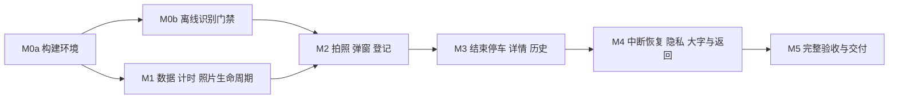

# ParkTick 实施计划

- 日期：2026-10-31
- 业务基线：[停车计时需求](parking-timer.md)
- 技术基线：[技术方案](../../design/technical-solution.md)
- 状态：源码、开发验证构建与可达环境回归已完成；正式识别质量和目标双机验收仍未关闭。验证更新于 2026-11-02，不能把开发构建可操作误写为阶段正式放行。

## 1. 实施原则与依赖

先关闭工具链和真实离线识别风险，再完成完整停车业务。数据层可与识别源码修订并行，但正式拍照登记必须等待真实识别门禁通过，不能用假的识别器或永久手工输入路径绕过。

当前已接通 M2 / M3 的开发验证构建以执行真实链路排查，但不视为绕过 M0b 正式放行，不将测试签名包当作已验收生产版本。

M0 指 M0a 与 M0b。技术方案中映射到 M0 的识别能力，只有 M0b 通过后才算具备接入条件。

| 阶段 | 前置条件 | 主要交付物 | 放行标准 |
| --- | --- | --- | --- |
| M0a 构建环境 | 已确认 PRD 和技术基线 | 可复现原生 Android 工程、版本目录、Wrapper、构建说明 | JDK 17 / SDK 环境可用，基础 APK 可构建并安装 |
| M0b 识别验证 | M0a | 可追溯修订源码 / JNI / APK、模型与许可清单、设备测量报告 | G1–G5 全部关闭，实际断网运行识别，不用旧库未验证状态放行 |
| M1 数据与时钟 | M0a，可与 M0b 并行 | Room 表与迁移、登记 / 结束事务、时钟与照片存储实现 | 唯一性、回滚、时间来源、文件归属及删除恢复可执行验证通过 |
| M2 拍照登记 | M0b、M1 | CameraX 拍照、车牌确认弹窗、实际在停列表 | 拍照起点正确，车牌可直接修改，确认后按最终值去重并保存 |
| M3 完整停车闭环 | M2 | 详情、结束确认、照片清理、历史与搜索 | 登记到结束到再次停车端到端可用，历史不留照片 |
| M4 可靠性与易用性 | M3 | 中断 / 重启 / 失败恢复、隐私配置与实机交互验证记录 | 所有关键异常路径不丢记录、不误删照片，大字和返回可实际操作 |
| M5 交付验收 | M4 | 签名 APK、校验值、依赖许可、构建及验收记录、更新后的文档 | A-01 至 A-23 全部有行为证据，工程门禁通过，无未说明的关键阻塞 |

## 2. M0a：建立可复现的 Android 构建环境

### 工作

- 配置 JDK 17、Android SDK API 36、对应构建工具和 Gradle 8.13 Wrapper，不以当前注册的 JDK 8 直接构建。
- 建立 Kotlin / Compose 单应用模块，采用技术方案指定的 AGP、Kotlin、KSP、Compose BOM、CameraX、Room 版本；锁定其余 AndroidX、NDK、CMake 和 native 依赖的精确版本。
- 配置 minSdk 24、compile / targetSdk 36；构建路径、SDK 本机路径和签名凭据分离，不提交机器私有路径或密钥。
- 建立四个业务目的地的导航约定、统一字体与按钮规格；车牌确认只作为拍照页弹窗，不增加确认页面。
- 以坚果 Pro 3、Redmi Note 14 Pro 5G（天玑 7300-Ultra）两款实际使用设备为必测机，分别记录具体型号 / SKU、Android / ROM 版本、ABI、物理内存和内存页大小；另准备 16KB ARM64 环境，保留低版本与 ARMv7 兼容性矩阵。

### 放行证据

Gradle 依赖解析、构建、两款目标设备分别安装成功，完成各自配置采集；公开型号规格不能替代实机记录。此阶段只有环境可用的含义，不能将空界面或构建成功称为 App 完成。

## 3. M0b：先行关闭离线识别风险

### 工作

- 固定 SDK tag 和 native 源码 commit，建立本地修订及可复现构建记录；模型、打包的 native 库与 APK 记录 SHA-256。当前在 `:app` 内源码构建自有 JNI，不另建没有独立消费者的 AAR。
- 修订内部私有模型目录、初始化错误传播、release 状态、JNI 数组 / buffer 释放及必要混淆规则。
- 用兼容 16KB 的工具链完整重编 ARM64 库及其 native 依赖；ARMv7 按对应平台验证。不能只把旧 `.so` 放进新版工程。
- 归档 Apache-2.0 及实际使用的 MNN、OpenCV、模型与静态链接组件物料和许可义务；未完成清单不能称为合规通过。
- 用真实本地照片运行完整检测与识别。三类车牌各准备至少 30 张有合法使用权限、可人工核对的样本，分别统计整牌正确 / 错误 / 未检出和耗时；夜间、斜拍、模糊、多车牌与旋转单独记录，不用演示图代替全部类别。
- 首次安装前断网，验证模型不下载、不请求在线授权；检查合并 manifest 没有 INTERNET。重复识别观察 native 内存与释放，执行 debug 和混淆 release 构建。

### 放行证据

技术方案 G1–G5 全部通过：修订制品来源清楚、许可清单完整、生命周期可靠、目标 ABI / 16KB 验证通过、三类车牌有真实离线结果和样本报告。识别率、耗时、安装包大小必须写测量值，不填宣传值或未经运行的保证。

若模型无法实际完成三类识别、授权链无法关闭或 native 无法兼容，暂停 M2，明确失败证据并解决选型问题；不删减离线识别需求，不改用联网服务，也不把手动输入当作门禁通过。

## 4. M1：数据、计时与照片生命周期

### 工作

- 实现 `active_parking`、`parking_history`、`pending_photo_deletions`，在停车牌唯一约束与显式 Room 迁移。
- 实现最终车牌规范化、事务登记与冲突返回原记录，不用覆盖写入。
- 实现拍照 / 结束时钟锚点；同次开机单调计时，跨重启墙钟估算，不可靠时间明确标记。
- 实现结束事务：写历史和照片删除任务、移除在停；提交失败回滚，提交后才删照片。
- 照片以记录标识命名，集中保存在内部不备份目录；实现草稿取消、重拍、重复登记与中断后的归属清理。
- 为列表提供实际数据库查询和一个前台刷新信号，不为每辆车维护后台服务或每秒写入。

### 放行证据

在真实 Room / SQLite 上验证重复与并发登记、历史再次停车、事务保存失败、重复结束及删除中断。单元回归聚焦最终车牌、计时来源、重启识别和改时边界；不添加依赖声明、源码文字或 mock 转发之类测试。

设计阶段的 SQLite 烟测仅作为历史设计证据；当前已在 Android Room 执行事务与照片归属回归，具体结果见[运行验证记录](../../reference/verification.md)，仍不替代两台目标机的正式验收。

## 5. M2：拍照、弹窗与登记

### 工作

- 接通 CameraX 取景、权限申请和本地拍照。捕获开始回调采样时间，保存成功后才采纳锚点并启动识别。
- 照片识别完成后，在拍照页弹出车牌确认框：大字可编辑车牌、照片缩略图、拍照时间、确认 / 重拍 / 返回。
- 修改车牌无需跳转页面，无需再次弹窗确认；识别失败在同一弹窗手动填写或重拍。
- 点击确认后，以最终车牌登记；已有在停记录则展示原记录、清理新临时照片。确认前不创建记录。
- 返回 / 重拍后废弃旧推理结果，避免迟到的回调重新显示弹窗或保存记录。
- 登记成功回到真实在停列表，按起点升序显示与搜索；提交期间防重复触发，但最终约束仍由数据库保证。

### 放行证据

在设备上实际拍摄并操作：识别正确直接确认、错误后修改、未识别手动填写、修改后命中重复、原识别重复但改成另一车牌、重拍和取消。核对拍照时间没有被识别或确认时间替换。

对应 PRD：A-01 至 A-05、A-10、A-11、A-19 至 A-23 的登记部分。

## 6. M3：结束停车与历史闭环

### 工作

- 完成停车详情，展示照片、开始时间和当前时长，提供明确返回与结束入口。
- 首页和详情的结束按钮共用二次确认，展示目标车牌、当前时长及删除照片提示。
- 点击最终确认时采样结束时间，调用结束事务并清理照片；不以弹窗打开时刻或文件删除完成时刻结束计时。
- 保存失败继续保留原记录与照片；保存成功但照片删除失败则单独提示清理未完成，不伪装为整个操作回滚或照片已删除。
- 历史按结束时间倒序，展示起止时间及固定总时长，支持车牌搜索；历史详情没有照片与结束入口。
- 同车牌再次登记生成新的独立记录，不修改历史。

### 放行证据

运行完整场景：拍照 → 改车牌 → 确认登记 → 等待 → 结束确认 → 查历史 → 同车牌再次停车。检查数据库值及应用文件目录，证明时间正确、旧照片已删除、新照片不受影响。

对应 PRD：A-06 至 A-08、A-12 至 A-18。

## 7. M4：失败、中断、隐私和易用性

| 验证维度 | 必测行为与证据 |
| --- | --- |
| 退出、锁屏、进程终止、重启 | 正式记录持久化；重开时恢复列表与时长；重启后的估算来源明确，不跨 boot 相减单调钟 |
| 拍照与推理中断 | 保存失败不建记录；取消 / 重拍后不处理旧结果；进程重启清理未确认草稿，不清理在停照片 |
| 结束持久化失败 | 原在停记录与照片保留，不出现结束成功 |
| 提交后清理失败或中断 | 真实结束时间已保存；删除任务可恢复；失败提示如实；同牌新照片不被旧任务误删 |
| 系统改时与跨日 | 同 boot 时长不随墙钟跳变；跨重启异常不伪造精确时长；超过 24 小时不归零 |
| 权限与存储 | 相机拒绝 / 撤销、空间不足均有可理解反馈与返回入口，不创建半条记录 |
| 仅本机与备份 | 无 INTERNET；无相册副本；数据库、WAL / SHM、照片和设置均排除标准云备份 / 迁移 |
| 大字与操作 | 标准字号、系统 200% 大字、键盘打开和窄屏下实际点选；返回与主要按钮可见、可点、不裁切 |
| Native 生命周期 | 反复拍照识别、离开 / 返回页面、release 混淆包，检查内存和初始化行为，不只验证第一次调用 |

删除失败后恢复依赖应用再次运行；强制停止期间不能保证清理时限。验收报告需要记录这一系统边界，不声称已做到后台永久保证或取证级安全擦除。

## 8. M5：验收与交付

### 必须交付

- 完整 Android 源码、Gradle Wrapper、锁定依赖、可追溯 native 修订和构建方法。
- 可安装的签名 APK 与 SHA-256；密钥私下保管，不写入仓库。
- 模型、识别库及全部第三方依赖的许可 / NOTICE 与来源清单。
- 坚果 Pro 3 和 Redmi Note 14 Pro 5G 分别覆盖 A-01 至 A-23 的验收记录，含具体设备 / SKU、Android / ROM 版本、ABI / 内存页信息、实际操作结果和必要截图；一台通过不能替代另一台。
- 识别样本分类统计、实测耗时 / 内存 / 包体积；记录失败样本和真实边界，不宣称未经验证的识别率。
- 更新后的需求、技术方案、实施状态与变更记录；功能完成后按文档生命周期将需求移入已实现目录，并同步所有链接。

### 完成定义

只有全部业务验收、G1–G5 与关键中断 / 隐私 / 易用性场景都具备真实运行证据，才称为完成。编译成功、空界面、仅列表可用、纯手动输入或模拟识别均不算交付。尚无真实设备时，不将相机、识别、16KB 或视觉验收标为通过。

## 9. 本次状态与下一执行入口

已建立可构建、可安装的原生 Android 工程并完成主要业务源码；已执行真实 native 推理、Room 回归和模拟器实际交互。需求 A-01 至 A-23 的逐项证据与缺项见[运行验证记录](../../reference/verification.md)，构建复现见[构建与安装](../../runbooks/android-build.md)。

| 阶段 | 当前执行状态 | 未关闭条件 |
| --- | --- | --- |
| M0a | 私有 JDK 17 / SDK、Wrapper、版本锁及 Debug / Release 构建可用 | 两台用户手机的实际配置采集与安装待执行 |
| M0b | 原绿牌漏字已修复；蓝 / 绿两张固定回归样本精确匹配，API 24 / 36 与 16KB 环境实际运行；ARM64 翻译下 R8 JNI 已验证 | 固定挑战集蓝牌 26/30、绿牌 11/30 正确，不能代表泛化准确率；黄牌合法 30 张、原生 ARM 与双机速度 / 内存仍待验，不放行 |
| M1 | Room 13 项检查通过，时钟 / 归一化单元 8 项通过；实际事务回滚、照片删除失败及恢复、并发去重 / 结束已检查 | 目标机满盘、异常存储与中断仍需复核 |
| M2 | CameraX 拍照、同弹窗编辑、最终值去重、原起点与原照片保留已在模拟器操作 | 实车正检预填与两台相机 / 输入法待验，不冒充识别通过 |
| M3 | 详情与首页结束、最终确认时间、物理删除、同牌新停车、历史倒序 / 搜索已操作 | 两台目标机复核 |
| M4 | 标准字号 / 200%、横屏 / 键盘 / 返回、权限拒绝及旋转、强停 / 锁屏 / guest 重启、照片写入失败与快速回前台清理恢复已验证；最低 API 24 已实际运行 | OEM 备份 / 迁移、真机满盘及其余 ROM 行为待验 |
| M5 | Debug、R8 未签名 Release 和测试签名 Release、SHA-256 与许可证据已产出；API 24 / 36 / 16KB 环境各 16 项 Android 检查通过，R8 ARM64 翻译运行通过 | 不能将翻译环境当作原生 ARM 真机；正式签名、双机 A-01 至 A-23 与 G1–G5 未关闭，不正式发布 |

下一执行入口是连接坚果 Pro 3、Redmi Note 14 Pro 5G，采集合法黄牌样本并复核真实车牌识别质量，在原生 ARM 设备按同一检查矩阵关闭 M0b / M5。完整环境、已修问题、质量差距与证据见[回归验证记录](../../reference/verification.md)。开发构建没有削减离线识别、照片删除、数据保留或大字返回要求；需求保持在 `planned/`，不提前迁入已实现目录。

